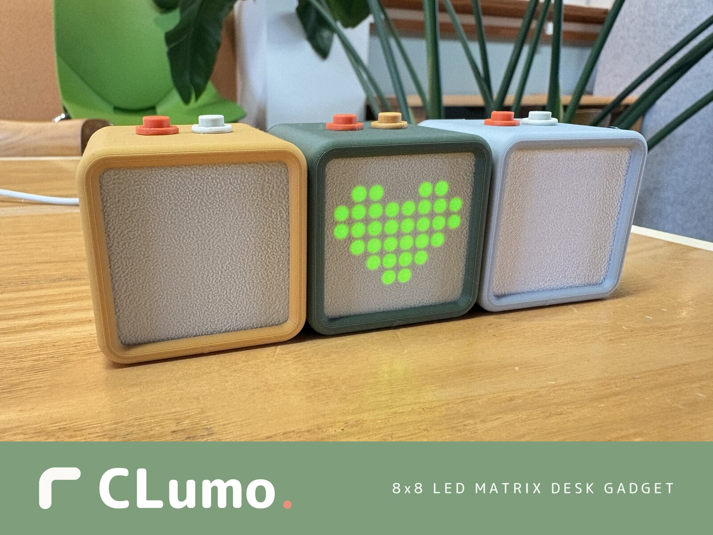
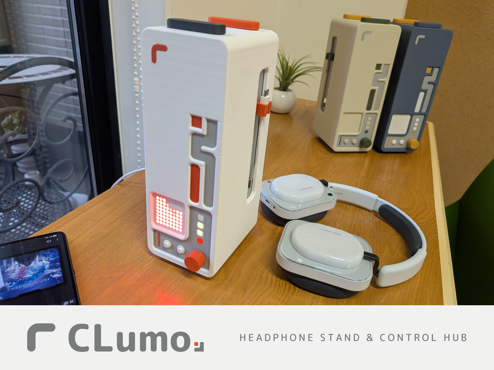
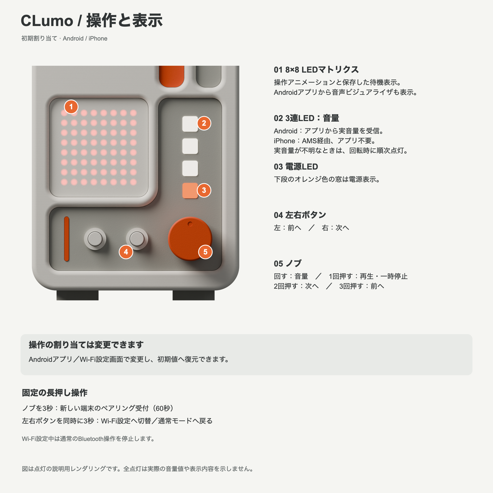

# CLumo

[English](README.md) | 日本語

CLumoは、ESP32-C3と8×8 LEDマトリクスを使った卓上ガジェットのシリーズです。従来の手のひらサイズのCLumoは、デジタルペットやタイマー、スマホから操作できる表示器。ヘッドホンスタンド版は、ヘッドホン置き場に音量ノブとメディア操作を組み合わせています。

## CLumoを選ぶ

| ハードウェア | ファームウェア | 主な機能 | スマホとの連携 |
| --- | --- | --- | --- |
| 従来CLumo | [単独版](standalone/README.ja.md) | デジタルペット、25分／5分ポモドーロ、サイコロ | スマホ不要 |
| 従来CLumo | [アプリ協調版](companion/README.ja.md) | 時間設定可能なポモドーロ、タイマー、自作表示、ビジュアライザ | Androidアプリ |
| ヘッドホンスタンド | [スタンド版](headphone-stand/) | メディア操作、実音量LED、自作待機アニメーション | 音量はAndroidアプリまたはiPhone AMS、ビジュアライザはAndroidアプリ |

単独版とアプリ協調版は従来CLumoの同じハードウェアで切り替えられます。スタンドは配線が異なるため、専用ファームウェアを使います。

## 従来のCLumo

3Dプリントした小さな筐体に、表示器と2つのボタンを備えています。単独でペット・ポモドーロ・サイコロを楽しむほか、協調版ではAndroidアプリからタイマー、自作表示、オーディオビジュアライザを使えます。

- [単独版の機能と操作](standalone/README.ja.md)
- [協調版の機能とAndroid接続](companion/README.ja.md)
- [部品・配線・写真付き組み立てガイド](hardware/assembly/README.ja.md)
- [印刷用の筐体モデル](hardware/models/clumo.3mf)

## ヘッドホンスタンド

初期割り当てでは、ノブを回して音量調整、1回押して再生／一時停止、2回で次へ、3回で前へ。左右のボタンでも前へ／次へを操作できます。割り当てはAndroidアプリとWi-Fi設定ページから変更できます。3連LEDはスマホの実音量を表示し、マトリクスには操作表示や自作の待機アニメーションを表示できます。

- **Android：** BLE HIDでメディア操作。共通CLumoアプリが音量とオーディオビジュアライザを配信します。
- **iPhone：** BLE HIDとApple Media Service（AMS）により、アプリなしでメディア操作と実音量LEDを使えます。AndroidのオーディオビジュアライザはiPhoneには対応していません。
- **表示の編集：** AndroidアプリからBluetoothで編集するか、左右ボタンを同時に3秒長押ししてWi-Fi設定ページを使います。どちらもプリセット選択、静止画、最大8コマのアニメーション編集に対応します。同じ長押しでBluetoothの通常モードへ戻ります。保存だけでは設定モードを終了しません。
- **ペアリング：** 新しいスマホを登録するときはノブを3秒長押し。登録済みスマホへの再接続では長押し不要です。

[Android／iPhoneの機能比較](headphone-stand/publishing/features.ja.md) · [アプリ・設定画面の資料](headphone-stand/publishing/README.md)

[ハードウェア・配線・印刷案内](hardware/headphone-stand/README.ja.md) · [配線図（SVG）](hardware/headphone-stand/img/clumo-headphone-stand-wiring.svg) · [P1S用印刷プロジェクト（3MF）](hardware/headphone-stand/models/clumo-headphone-stand-p1s.3mf)

3MFは4プレート・33部品を収録し、ユーザーが調整したP1S向け設定を保持しています。プレート構成と印刷上の注記はハードウェア案内を参照してください。[写真付きアセンブリガイド（日本語）](hardware/headphone-stand/assembly/clumo-assembly-ja.pdf)・[英語版](hardware/headphone-stand/assembly/clumo-assembly-en.pdf)も参照できます。

## 導入手順

**従来CLumo：** [ブラウザインストーラー](https://cespresso.github.io/CLumo/)で単独版／アプリ協調版を選び、USB経由で書き込みます。協調版では[最新リリース](https://github.com/Cespresso/CLumo/releases/latest)の`clumo.apk`を導入し、パスキー`123456`でペアリングします。

**ヘッドホンスタンド：** [専用ファームウェアのビルド・書き込み手順](headphone-stand/firmware/README.md#ビルド検査既存実機への書き込み)に従ってください。[ブラウザインストーラー](https://cespresso.github.io/CLumo/?fw=headphone-stand)は、`clumo-headphone-stand.bin`と`clumo.apk`を含むリリースの公開後に利用できます。それまではソースからビルドしてください。v4プロトコルを使うため、Androidアプリはファームウェアと同じリリースのものを使用します。スタンドのペアリングに従来CLumoのパスキー`123456`は使いません。

## リポジトリ構成

| パス | 内容 |
| --- | --- |
| [`standalone/`](standalone/) | 従来CLumoの単独版ファームウェア |
| [`companion/firmware/`](companion/firmware/) | 従来CLumoの協調版ファームウェア |
| [`companion/android/`](companion/android/) | 共通Androidアプリ |
| [`headphone-stand/`](headphone-stand/) | スタンド用ファームウェア・プロトコル・検証記録 |
| [`hardware/assembly/`](hardware/assembly/) | 従来CLumoの組み立てガイド・配線 |
| [`hardware/headphone-stand/`](hardware/headphone-stand/) | スタンドの配線図・印刷用3MF・出典 |
| [`installer/`](installer/) | 3種類のファームウェアに対応するブラウザインストーラー |

## ソースからのビルド

ファームウェアはRustとESP-IDF v5.2.2を使用し、ターゲットは`riscv32imc-esp-espidf`です。[単独版](standalone/README.ja.md)、[協調版](companion/firmware/)、[スタンド版](headphone-stand/firmware/)それぞれの手順を参照してください。スタンド版は実機用ビルドオプションの指定が必要です。[Androidアプリ](companion/android/README.ja.md)はGradleまたはAndroid Studioでビルドします。

## ライセンス

[MIT](LICENSE)
