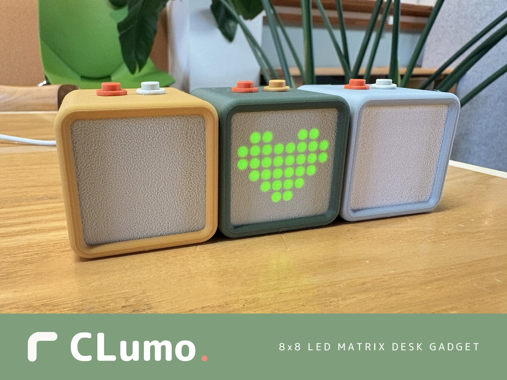
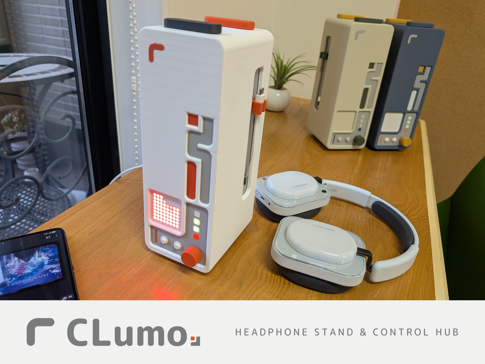
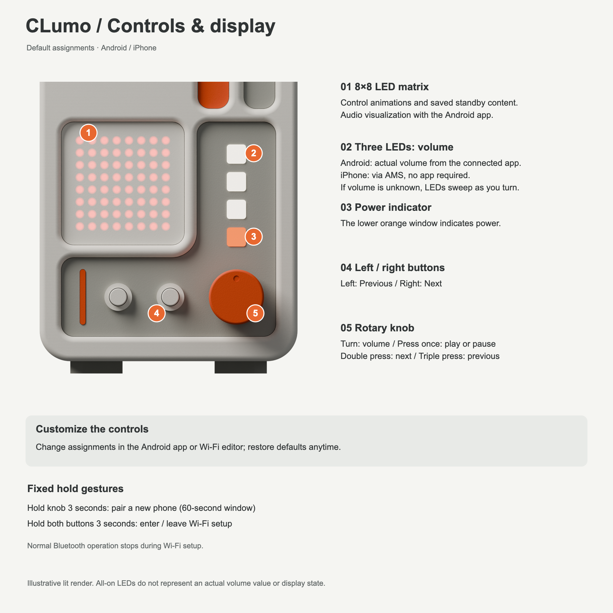

# CLumo

English | [日本語](README.ja.md)

CLumo is a family of ESP32-C3 desk gadgets with an 8×8 LED matrix. The original palm-sized CLumo is a digital pet, timer and phone-controlled display. The headphone stand adds a place for your headphones, a volume knob and media controls.

## Choose your CLumo

| Hardware | Firmware | What it does | Phone support |
| --- | --- | --- | --- |
| Original CLumo | [Standalone](standalone/) | Digital pet, 25/5 pomodoro, dice | No phone needed |
| Original CLumo | [Companion](companion/) | Configurable pomodoro, timer, custom patterns, audio visualizer | Android app |
| Headphone stand | [Stand firmware](headphone-stand/) | Media controls, actual-volume LEDs, custom standby animations | Android app or iPhone AMS for volume; Android app for visualization |

Standalone and companion share the original hardware. The stand has different wiring and needs its own firmware.

## Original CLumo

Two buttons control a small display in a 3D-printed enclosure. Use it on its own for the pet, pomodoro and dice, or pair the companion firmware with the Android app for timers, custom displays and audio visualization.

- [Standalone features and controls](standalone/)
- [Companion features and Android setup](companion/)
- [Parts, wiring and photo assembly guide](hardware/assembly/)
- [Printable enclosure](hardware/models/clumo.3mf)

## Headphone stand

By default, turn the knob for volume, press once to play or pause, twice for next, and three times for previous. The left and right buttons also select previous and next. Customize these assignments in the Android app or Wi-Fi setup page. Three LEDs show the phone's actual media volume. The matrix shows control feedback and a customizable standby display.

- **Android:** media controls work over BLE HID; the shared CLumo app supplies volume and the audio visualizer.
- **iPhone:** media controls and actual-volume LEDs work without an app, using BLE HID and Apple Media Service (AMS). The Android audio visualizer is not available on iPhone.
- **Display editing:** use the Android app over Bluetooth, or hold both side buttons for 3 seconds to enter Wi-Fi setup. Both editors support presets, still images and animations of up to eight frames. Hold the buttons again to return to Bluetooth mode; saving alone does not exit setup.
- **Pairing:** hold the knob for 3 seconds to pair a new phone. Reconnecting a registered phone does not require a long press.

[Android / iPhone feature comparison](headphone-stand/publishing/features.md) · [App and setup screenshots](headphone-stand/publishing/README.md)

[Hardware, wiring and printing](hardware/headphone-stand/) · [Wiring diagram (SVG)](hardware/headphone-stand/img/clumo-headphone-stand-wiring.svg) · [P1S print project (3MF)](hardware/headphone-stand/models/clumo-headphone-stand-p1s.3mf)

The 3MF contains four plates and 33 parts, with the user's saved P1S settings. See the hardware guide for the plate contents and printing notes. See the [photo assembly guide (English)](hardware/headphone-stand/assembly/clumo-assembly-en.pdf) or [Japanese edition](hardware/headphone-stand/assembly/clumo-assembly-ja.pdf).

## Get started

**Original CLumo:** use the [browser installer](https://cespresso.github.io/CLumo/) to choose standalone or companion and flash over USB. For companion, install `clumo.apk` from the [latest release](https://github.com/Cespresso/CLumo/releases/latest) and pair using passkey `123456`.

**Headphone stand:** follow the [stand firmware build and flashing instructions](headphone-stand/firmware/README.md#ビルド検査既存実機への書き込み) (currently in Japanese). The [browser installer](https://cespresso.github.io/CLumo/?fw=headphone-stand) supports the stand once a release containing `clumo-headphone-stand.bin` and `clumo.apk` is published. Until then, build from source. Use the Android app from the same release: the stand uses protocol v4. Stand pairing does not use the original CLumo's `123456` passkey.

## Repository layout

| Path | Contents |
| --- | --- |
| [`standalone/`](standalone/) | Original CLumo standalone firmware |
| [`companion/firmware/`](companion/firmware/) | Original CLumo companion firmware |
| [`companion/android/`](companion/android/) | Shared Android app |
| [`headphone-stand/`](headphone-stand/) | Stand firmware, protocol and verification notes |
| [`hardware/assembly/`](hardware/assembly/) | Original CLumo assembly guide and wiring |
| [`hardware/headphone-stand/`](hardware/headphone-stand/) | Stand wiring, printable 3MF and source provenance |
| [`installer/`](installer/) | Browser installer for all three firmware variants |

## Building from source

Firmware uses Rust and ESP-IDF v5.2.2, targeting `riscv32imc-esp-espidf`. Follow the instructions for [standalone](standalone/), [companion](companion/firmware/) or the [stand](headphone-stand/firmware/); the stand requires explicit device build flags. Build the [Android app](companion/android/) with Gradle or Android Studio.

## License

[MIT](LICENSE)
