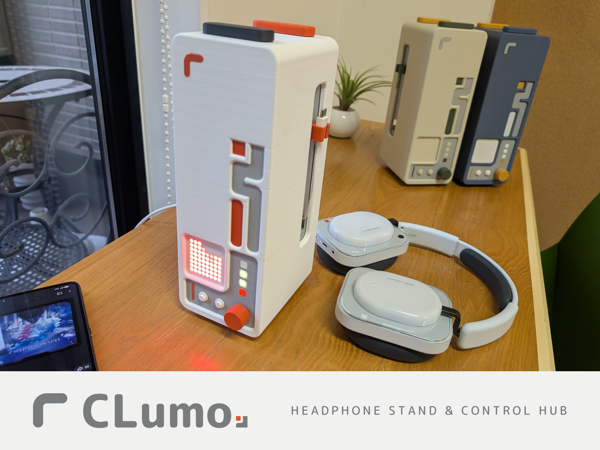
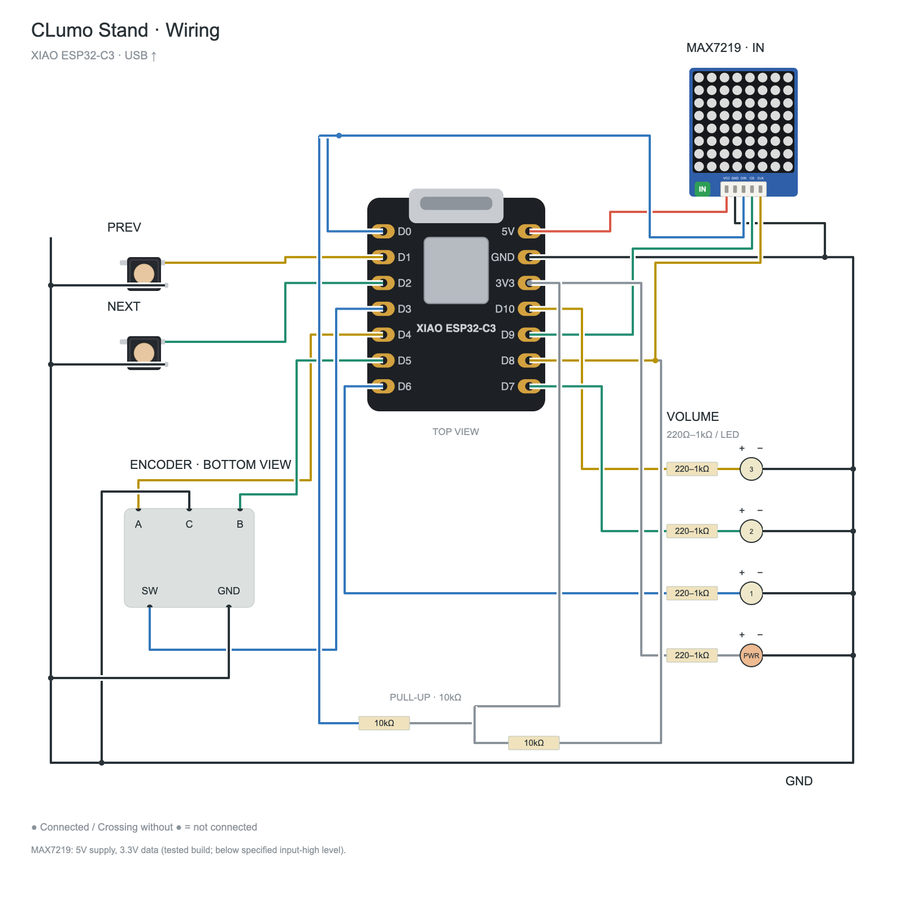

# CLumoヘッドホンスタンドのハードウェア

[English](README.md) | 日本語



XIAO ESP32-C3、MAX7219マトリクス、前曲／次曲ボタン、押込み付きロータリーエンコーダー、音量LED3灯、電源LEDを使うヘッドホンスタンドです。従来CLumoとは配線が異なります。[スタンド専用ファームウェア](../../headphone-stand/)を使用してください。

## 印刷用プロジェクト

[clumo-headphone-stand-p1s.3mf](models/clumo-headphone-stand-p1s.3mf)をダウンロードし、Bambu Studioのプロジェクトとして開きます。機種とプリンターを区別できる名前に変更していますが、中身は最新版の`clumo_final_four_plates_p1s_studio_v3_spacing_20261114.3mf`と完全一致します。元データではプレート4の1層目の干渉を解消するため、重りケースをY+へ20 mm・X+へ10 mm、蓋をX+へ10 mm移動しています。形状と印刷設定は保持されています。

| プレート | 内容 | 個数 |
| --- | --- | ---: |
| Outer Shell | 外殻 | 1 |
| Rear Cover | 裏蓋 | 1 |
| Exterior Parts and Holders | 操作パネル、装飾部品、ロゴ、ボタン／リング、ノブ、マトリクス表面パネル、LED窓4個、ケーブルクリップ、端子ホルダー、固定ナット2個、ヘッドバンドストッパー2個 | 22 |
| Internal Structure and Feet | 印刷ボルト脚4個、内骨格、操作・マトリクス一体受け、LED押さえ、重りケースと蓋 | 9 |

合計**4プレート・33部品**。保存済み設定はBambu Lab P1S、0.4 mmノズル、積層0.12 mm、tree(auto)サポート有効です。保存プロセス名は`0.12mm High Quality @BBL X1C`。G-codeは含まれないため、使用するプリンターと材料に合わせてスライスしてください。部品色は作例で、LED窓4個は同じ形状です。マトリクス表面パネルとLED窓は光の透過を実物で確認してください。

開放型ケーブルクリップは使いやすさ重視、交換用端子ホルダーは見た目重視で、左右で混在できます。重りケースには重りを入れられますが、推奨重量は未確定です。滑り止めの使用例は3M SJ5302（直径7.9 mm、厚さ2.2 mm）を4脚に貼り付ける構成です。

旧自動配置スクリプトではユーザーの最終調整を再現できないため、この3MFを再生成で上書きしないでください。制作元のセッションで全4プレートの「Slice ok」と干渉警告なしを確認済みです。合計見積もりは34時間21分・559.32 g。今回の取り込みではハッシュ、ZIP整合性、プレート・部品数、保存設定を確認し、再スライス・実印刷は行っていません。

## 配線

[拡大用SVG](img/clumo-headphone-stand-wiring.svg) · [PNG](img/clumo-headphone-stand-wiring.png)



XIAOはUSBを上にした向き、エンコーダーは裏側から見た配置です。交点の丸は接続、丸のない交差は非接続です。

| 接続先 | XIAO / GPIO |
| --- | --- |
| MAX7219 DIN / CLK / CS | D0 / 2、D8 / 8、D9 / 9 |
| 前曲／次曲 | D1 / 3、D2 / 4 |
| エンコーダー押込み／A／B | D3 / 5、D4 / 6、D5 / 7 |
| 音量LED 上／中／下 | D10 / 10、D7 / 20、D6 / 21 |
| 電源LED | 3V3から個別抵抗を経由 |

- マトリクスは**IN側**を接続。電源はUSB 5V、GNDはすべてXIAO GNDへ戻します。
- 各LEDに**220 Ω〜1 kΩの直列抵抗を1本ずつ**使います。GPIO→抵抗→アノード、カソード→GNDです。D0とD8に示す**起動用10 kΩプルアップ**とは用途が異なります。
- ボタンとエンコーダーは内部プルアップ、接点の反対側はGND。エンコーダーCはGNDで、固定用の脚には配線しません。組み立て時に時計回りと音量増加の対応を確認してください。
- 作例は5VのMAX7219へ3.3V信号を直結しています。実機個体で動作確認済みですが、High入力規定を下回る構成であり、全モジュールでの動作保証ではありません。
- 制作元の記録では、実装したLED抵抗の正確な値と追加起動プルアップの実装有無は未記録です。図は接続設計を示し、すべての実物について測定した結果ではありません。

組み立て順序は[写真付きアセンブリガイド（日本語）](assembly/clumo-assembly-ja.pdf)・[英語版](assembly/clumo-assembly-en.pdf)を参照してください。電気的な接続先は、このページの配線図を併用します。

## 出典と配線図の再生成

`maker-projects`の`nothing-headphone-accessory`からコピーしました。元の相対パスとSHA-256は[sources.json](sources.json)に記録しています。カバーは採用済み実物写真、配線図はコミット`64567b6`の掲載用採用版、3MFの旧版は`c69dae2`／`6d5742f`で確定したもので、今回の配置修正版は元ファイルのパスとSHA-256で識別しています。

配線図生成元と部品画を`wiring/`に同梱しており、別リポジトリへの依存はありません。CLumoルートから実行します。

```sh
python3 hardware/headphone-stand/wiring/build_diagram.py
# PNGも再生成する場合はCairoSVGを導入して実行:
cairosvg hardware/headphone-stand/img/clumo-headphone-stand-wiring.svg \
  -o hardware/headphone-stand/img/clumo-headphone-stand-wiring.png
```

部品画は同じmaker-projects内の`nfc-matrix/matrix/publishing/parts.py`からコピーしました。生成元はimport先と出力先だけを変更し、受領したPNGはそのまま保持しています。
