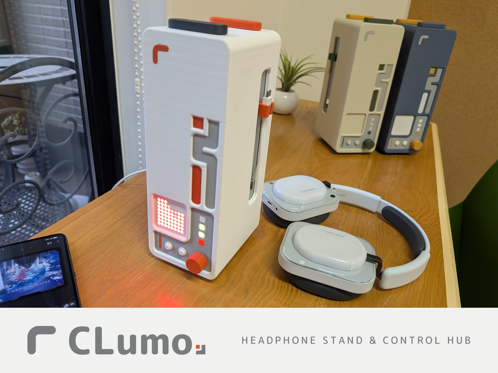
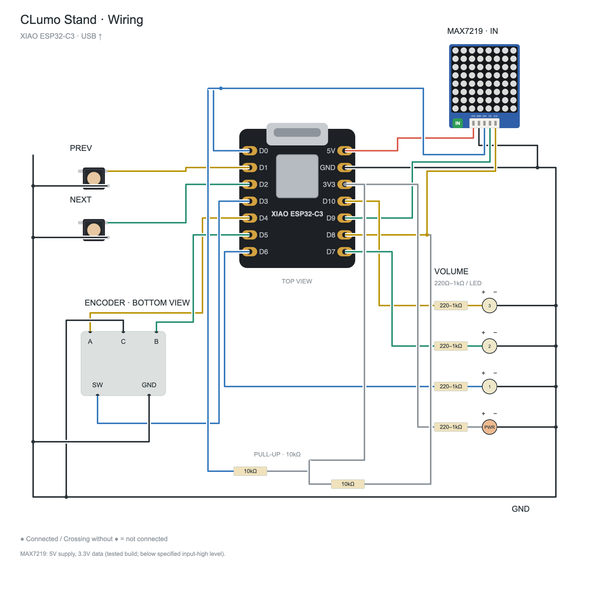

# CLumo headphone stand hardware

English | [日本語](README.ja.md)



This is the headphone stand hardware, with a XIAO ESP32-C3, MAX7219 matrix, two track buttons, a push-button rotary encoder, three volume LEDs and a power LED. Its wiring differs from the original CLumo. Use the [stand firmware](../../headphone-stand/), not standalone or companion firmware.

## Print project

Download [clumo-headphone-stand-p1s.3mf](models/clumo-headphone-stand-p1s.3mf) and open it as a project in Bambu Studio. The filename identifies the product and printer; it is a byte-for-byte copy of the approved `clumo_p1s.3mf`, with no changes to parts, placement, orientation or print settings.

| Plate | Parts | Count |
| --- | --- | ---: |
| Outer Shell | Main enclosure | 1 |
| Rear Cover | Back cover | 1 |
| Exterior Parts and Holders | Control panel, trim, logo, buttons/rings, knob, matrix panel, four LED windows, cable clip, terminal holder, two nuts and two headband stops | 22 |
| Internal Structure and Feet | Four threaded feet, inner frame, control/matrix carrier, LED retainer, weight box and lid | 9 |

Total: **4 plates, 33 parts**. Saved settings: Bambu Lab P1S, 0.4 mm nozzle, 0.12 mm layers, tree(auto) supports enabled. The saved process name is `0.12mm High Quality @BBL X1C`. The project contains no G-code; slice it for your printer and material. Colours are examples, and all four LED windows share the same geometry. Check light transmission for the matrix panel and LED windows.

The included cable clip leaves the cable accessible; the alternative terminal holder prioritizes a tidy appearance. These can be mixed on the two sides. The weight box can hold ballast; a recommended weight has not yet been established. The user's non-slip feet use four 3M SJ5302 pads (7.9 mm diameter, 2.2 mm thick).

Do not overwrite this project using earlier automatic layout scripts: they do not reproduce the user's final adjustments. Import verification checked the file hash and ZIP integrity; this import did not re-slice or print it.

## Wiring

[SVG for zooming](img/clumo-headphone-stand-wiring.svg) · [PNG](img/clumo-headphone-stand-wiring.png)



The XIAO is shown with USB at the top. The encoder is shown from the underside. A dot marks a connected junction; a crossing without a dot is not connected.

| Connection | XIAO / GPIO |
| --- | --- |
| MAX7219 DIN / CLK / CS | D0 / 2, D8 / 8, D9 / 9 |
| Previous / Next | D1 / 3, D2 / 4 |
| Encoder switch / A / B | D3 / 5, D4 / 6, D5 / 7 |
| Volume LEDs: top / middle / bottom | D10 / 10, D7 / 20, D6 / 21 |
| Power LED | 3V3 through its own resistor |

- Connect the matrix's **IN** header. It receives USB 5V; all grounds return to XIAO GND.
- Each LED has its own **220 Ω–1 kΩ series resistor**. GPIO drives the anode through the resistor; the cathode returns to ground. These are separate from the **10 kΩ pull-ups** shown on D0 and D8.
- Buttons and encoder contacts use internal pull-ups and switch to ground. Encoder C is ground; do not wire its mounting tabs. Check actual clockwise volume direction when assembling.
- The pictured build connects 3.3V signals directly to the 5V MAX7219 module. This worked on the tested unit but is below the specified input-high level, so it is not a guarantee for every module.
- The source notes do not record the exact installed LED resistor values or whether the additional boot pull-ups were fitted. The diagram documents the intended connections, not measurements of every assembly.

Follow the [photo assembly guide (English)](assembly/clumo-assembly-en.pdf) or [Japanese edition](assembly/clumo-assembly-ja.pdf) for the assembly sequence. Use the wiring diagram on this page alongside the guide.

## Asset provenance and regeneration

Assets were copied from the `nothing-headphone-accessory` project in `maker-projects`. [sources.json](sources.json) records original paths and SHA-256 hashes. The cover uses the selected real photograph; the wiring is the approved publication version from commit `64567b6`. The approved print project is recorded in commits `c69dae2` / `6d5742f`.

The diagram generator and its part artwork are bundled in `wiring/`; they need no other repository. From the CLumo root:

```sh
python3 hardware/headphone-stand/wiring/build_diagram.py
# Optional PNG regeneration, with CairoSVG installed:
cairosvg hardware/headphone-stand/img/clumo-headphone-stand-wiring.svg \
  -o hardware/headphone-stand/img/clumo-headphone-stand-wiring.png
```

The part artwork was copied from `nfc-matrix/matrix/publishing/parts.py` in the same maker-projects repository. Only the generator's import/output paths were adapted. The imported PNG is preserved as provided.
