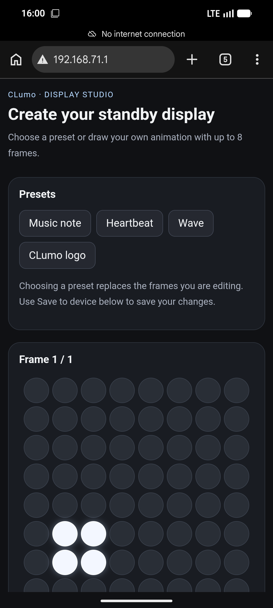
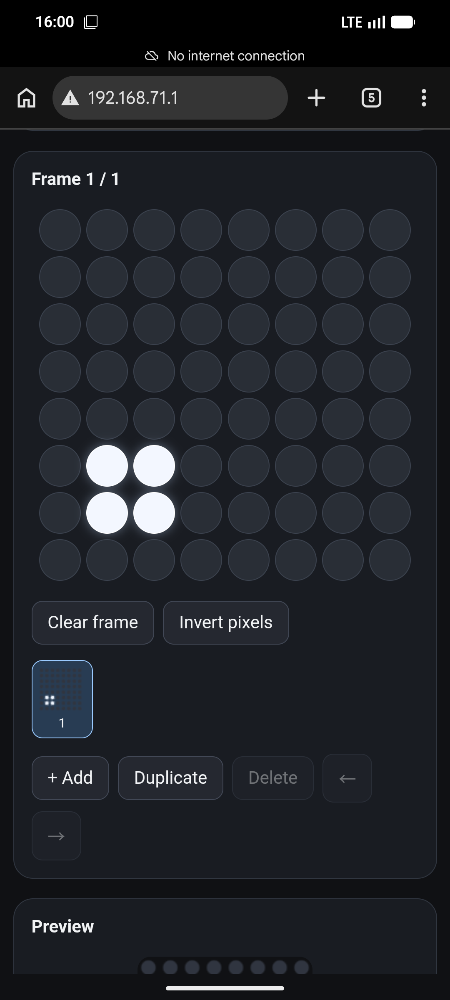
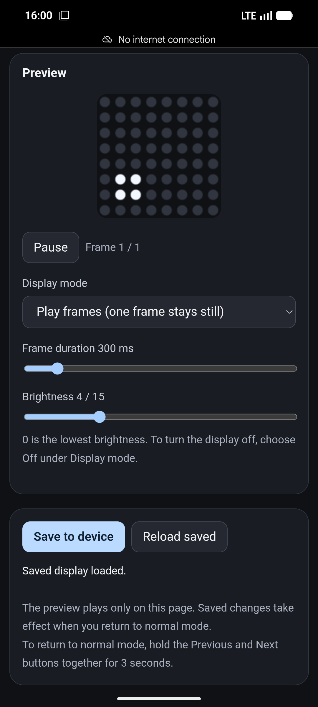

# ヘッドホンスタンド用ESP32ファームウェア

XIAO ESP32-C3用のRustファームウェア。CLumoのstandalone／companionに続く第3の構成で、BLE HIDによるメディア操作、AndroidアプリまたはiPhoneのAMSによる実音量取得、MAX7219の8×8表示を担当する。

この文書は2026-11-14時点の保守・実機検証の知見をまとめたもの。配線表、GATTプロトコル、開発履歴は[スタンド全体のREADME](../README.md)を参照。

## 現在の動作

- 前／次ボタン：前曲／次曲。ノブ回転：音量。短押し：再生／一時停止。
- ノブ3秒長押し：新規ペアリングを60秒受け付ける。既存の登録情報は消さない。
- 前＋次ボタンを同時に3秒長押し：再起動してWi-Fi設定モードへ切り替える。同じ操作で通常モードへ戻る。
- メディア操作はBLE HID Consumer Control。Androidアプリが動いていなくても操作できる。
- Androidはアプリが実音量を500ms周期で報告する。iPhoneはアプリ不要でAMSから取得する。音声ビジュアライザはAndroidアプリが必要。
- 3連LEDは実音量を優先する。取得中はノブを回してもシーケンスを出さず、音量0なら消灯する。不明なときだけ操作方向に1灯ずつ流し、最後の操作から180ms後に消灯する。途中で音量を取得したら直ちに実音量表示へ切り替える。
- マトリクスの＋／−パルスは実音量の有無にかかわらず操作方向を示す。

## コードの分担と状態管理

| ファイル | 担当 |
| --- | --- |
| `src/lib.rs` | 入力判定、表示状態、アニメーション、設定の符号化。ホストで検証できる処理 |
| `src/device.rs` | BLEサービス、コールバック、メインループ、各取得器の統合 |
| `src/connection.rs` | 接続世代、暗号化・HID準備状態、最新値メールボックス |
| `src/volume.rs` | 0～100の型付き音量、取得元と取得状態、Android報告の有効期限 |
| `src/ams.rs` | AMS通知の解析と探索世代の検証 |
| `src/ams_transport.rs` | NimBLE C APIを使ったAMS探索・購読・通知処理 |
| `src/hardware.rs` | GPIO、SPI、MAX7219出力 |
| `src/setup.rs` / `src/captive_dns.rs` / `src/editor.html` | 設定用Wi-Fi、キャプティブポータル、表示編集 |
| `src/setup_buttons.rs` | 設定モード切り替えの同時長押し判定 |

表示の揮発状態はメインループが所有する。BLEコールバックから直接表示を変えず、音量とビジュアライザはそれぞれ最新1件をメールボックスへ渡す。NVSへ保存する設定は別に管理する。

接続／切断／暗号化喪失で接続世代を更新する。同じ接続ハンドルが再利用されても、古い世代の通知やHID送信待ちを新しい接続へ持ち越さない。HID送信直前にも世代と準備状態を確認する。ロック順を変更する場合はコールバック側も含めて確認する。

## AndroidとAMSの音量を混同しない

共通の`VolumeSession`は取得元、Preparing／Available／Unavailable、値を管理する。音量不明を0や255で代用せず、値なしとして扱う。音量の有効性は取得器が判定し、表示側には有効な値だけを渡す。

| 項目 | Android | iPhone AMS |
| --- | --- | --- |
| 更新方法 | アプリから500ms周期の状態報告 | 値の変化時の通知 |
| 値が同じ場合 | 同じ値を報告し続ける | 通知が来ない時間がある |
| 失効 | 最後の報告から2秒 | 切断、購読のエラーなど |
| 復帰 | 次の正常な報告 | 探索・購読して正常な値を受信 |

AMSにAndroid用の2秒TTLを適用すると、操作していないだけで音量表示が消える。逆にAndroidの報告は、同値でも間引かない。アプリ停止と音量不変を区別するために必要。

Androidの専用サービスはINFO `[4,1]`、音量は`[0]`＝不明、`[1, percent]`＝0～100。旧v1〜v3とは互換性がないため、Androidとファームウェアをセットで更新する。

取得元は同じ接続内で競合させない。AMSを発見する前は取得元を確定せず、Androidが選ばれたらAMS処理を停止する。AndroidでAMSが見つからないこと自体は異常ではない。

## AMS実装で気をつけること

既存の暗号化BLE接続上でESP32がGATTクライアントとして動く。HIDの接続や操作経路は維持し、AMS Remote Commandは使わない。

1. AMSとGeneric Attributeサービスを探索する。
2. Service Changedのindicationを購読する。
3. AMS Entity Updateのnotificationを購読する。
4. Player Volume `[0,2]` を登録し、初期値を待つ。

通知の値は0～1のUTF-8数値として検証してから0～100へ変換する。NaN、範囲外、切り詰められた通知を実音量として採用しない。

初期値待ちは5秒、GATT操作待ちは35秒。エラー後は5秒で再試行し、AMS未公開時はService Changedと30秒周期の再探索に対応する。購読書き込みの完了より先に通知が来ても、初期値を失わないように保持する。

NimBLEの非同期処理に渡すコールバック用メモリは、完了コールバックまで保持する。タイムアウトだけで解放しない。切断やService Changedでは探索世代を無効化して古い結果を捨てる。世代の確認と結果の適用の間にも競合が起きるため、同じロック内で行う。新しいGATT操作の開始時も、キャッシュしたハンドルが属する世代を確認する。

参考：[Apple AMS仕様](https://developer.apple.com/library/archive/documentation/CoreBluetooth/Reference/AppleMediaService_Reference/Specification/Specification.html)、[Player Volumeの定義](https://developer.apple.com/library/archive/documentation/CoreBluetooth/Reference/AppleMediaService_Reference/Appendix/Appendix.html)。

## 接続トラブルで得た知見

### 登録済み端末への接続では長押ししない

通常の再接続に長押しは不要。現在の新規ペアリング受付中は登録済み／未登録の双方を許可する。切り替え元が自動再接続すると唯一の接続枠を占有するため、先に切り替え元で切断する。旧実装では登録済み端末を拒否し、iPhoneでタイムアウトしたが、片側だけ登録情報が残る場合の再ペアリングを妨げるため変更した。

`Reject peer: known=true pairing=true`は旧実装の拒否ログ。現行仕様ではこの組み合わせを許可する。認証やAMSの不具合と決めつけず、まずモードと接続相手を確認する。

### 最大接続数は1

別の登録済みスマホが接続していると、検証したい端末から接続できない。先に接続中の端末を切断する。登録削除は通常不要。`BLE connected ... peer=...`で接続相手を確認する。

iPhoneとAndroidを切り替える検証では、片方を明示的に切断してからもう片方を接続する。AndroidアプリのGATT切断だけではOSのHIDが物理BLE接続を保持する場合があるため、アプリ再接続テストと物理切断テストを区別する。

### Androidの接続待ちが残った場合

検証端末ではBluetoothをOFFにしても、常時スキャンが有効だとBLE_ONが残ることがあった。必要な場合に限り、元の設定を記録したうえで完全にOFF→ONにする。

```sh
adb shell am force-stop io.github.cespresso.clumo.debug
adb shell settings get global ble_scan_always_enabled
adb shell settings put global ble_scan_always_enabled 0
adb shell svc bluetooth disable
adb shell cmd bluetooth_manager wait-for-state:STATE_OFF
adb shell svc bluetooth enable
adb shell cmd bluetooth_manager wait-for-state:STATE_ON
# 検証端末の元の値は1。別端末では記録した値に戻す。
adb shell settings put global ble_scan_always_enabled 1
```

通常アプリを起動して一覧を表示するだけでは、対象スタンドの接続が始まらない場合がある。対象カードを開き、`App connection: Connected`とESP32の受信ログを確認する。

## ハードウェア・設定モードの知見

- MAX7219はSPI MODE0、2MHz。USB 5V電源、信号はレベル変換なしの実機構成で動作確認済み。この記録は別モジュールでの動作保証ではない。
- マトリクスの全点灯／無点灯が続いた際、モジュール交換で解消した例がある。初期化コードだけでなく電源、GND、配線、モジュール自体も切り分ける。
- 正面から見て従来CLumoより反時計回り90°の取り付け。出力直前に時計回り90°補正し、保存データやAndroidの論理座標は変換しない。
- LEDはHigh点灯、ボタン／エンコーダーは内部プルアップで共通端子GND。配線正本はスタンド全体READMEから参照する。
- Wi-Fi設定モードと通常BLEモードは再起動で切り替える実装。一般的なESP32のWi-Fi／BLE共存可否と、この製品のモード仕様を混同しない。
- 設定用APは`CLumo-Setup-XXXX`、ローカルIPは`192.168.71.1`。キャプティブポータルで案内し、自動表示されない場合は`http://192.168.71.1/`を開く。
- Android標準ポータルは大きなHTTPヘッダーを送るため、`CONFIG_HTTPD_MAX_REQ_HDR_LEN=2048`に設定している。
- 保存操作では設定モードを終了せず、Wi-Fiマークを維持する。実機プレビューも設けない。通常モードへ戻ったとき保存設定を適用する。

## ビルド・検査・既存実機への書き込み

この`firmware/`ディレクトリから実行する。ESP-IDF v5.2.2、4MBフラッシュを使用。ホストテストと実機ビルドでRustツールチェーンが異なる。

```sh
rustup run 1.97 cargo test --locked
rustup run stable cargo fmt --check
rustup run nightly-2025-11-01 cargo build --locked --release \
  --features device --bin headphone-stand \
  --target riscv32imc-esp-espidf -Z build-std=std,panic_abort
espflash save-image --chip esp32c3 --flash-size 4mb \
  target/riscv32imc-esp-espidf/release/headphone-stand target/headphone-stand.bin
```

この作業環境では取得済みESP-IDFとツールを次の環境変数で参照した。別環境ではインストール先に合わせる。別プロジェクトのファームウェアソースをビルドするわけではない。

```sh
export IDF_PATH=/Users/noguchinaoya/learn/maker-projects/nothing-headphone-accessory/firmware/.embuild/espressif/esp-idf/v5.2.2
export ESP_IDF_TOOLS_INSTALL_DIR=custom:/Users/noguchinaoya/learn/maker-projects/nothing-headphone-accessory/firmware/.embuild/espressif
```

既存の4MB用ブートローダー・パーティション表を持つ基板にはアプリ領域だけを書き込む。実際のポート名を確認し、シリアルモニターを終了してから実行する。

```sh
python -m esptool --chip esp32c3 --port /dev/cu.usbmodem101 --baud 460800 \
  write_flash 0x10000 target/headphone-stand.bin
```

`python`にはesptoolを導入した環境を使う。この手順ではNVS、ペアリング情報、保存した表示を保持する。新品基板には別途ブートローダー・パーティション表の準備が必要であり、アプリだけの書き込みを初回セットアップ手順として使わない。

USB Serial/JTAGログは115200bps。読み取りプロセスを複数起動するとログが分散するため1つにする。ポートを開くツールのDTR／RTS操作でリセットが起こり得る。USBの切断後は監視プロセスの終了も確認する。

## 検証の範囲と次回の確認

2026-11-14時点：ホストテスト44件成功、ESP32-C3 releaseビルド成功、1,370,784バイトを書き込みハッシュ一致。実音量取得中の3LEDシーケンス抑制はユーザー実機確認済み。

- iPhone：暗号化接続、AMS探索・購読、初期値と音量変化、ノブによる音量操作、3連LED追従を確認。
- Android：AMS追加後の`HeadphoneStandHardwareTest#volumeV2AndReconnect`成功。境界値、不明、報告停止、同値での回復、アプリGATT再接続をログと照合。通常アプリでの実音量受信も確認。
- iPhone→Androidの切り替えで接続世代更新と音量再取得を確認。
- 未確認：実機でのService Changedによる再探索、iPhone切断・再接続後の音量再取得、長時間運転。

通常の回帰には`volumeV2AndReconnect`を使う。`dedicatedGattSettingsAndReconnect`は表示設定を書き換える旧テストで、旧GATTからの復元では複数コマアニメーションまで復元できないため、保存作品のある実機で無条件に実行しない。

ログでは`BLE connected`、`BLE authentication`、`AMS`、`VOLUME session=...`、`VOLUME LED mask=...`を順に追う。実音量の通知が来たこと、GPIOへ出す点灯マスク、実物の見え方を分けて確認する。

### 設定ページの英語化

ESP32が配信する設定ページは英語に統一した。操作ラベル、説明、プリセット名、確認・エラー表示、読み上げ用ラベルとHTMLの言語指定を含む。Androidの日本語・英語対応は維持し、このREADMEなどの開発文書は日本語とする。

英語化版はreleaseビルド成功、1,370,320バイトを既存実機のアプリ領域へ書き込み、ハッシュ一致を確認。日本語文字の残存チェック、JavaScript構文、差分チェックも成功。Android実機をスタンドの設定APへ接続し、Chromeで英語の見出し・プリセット・編集操作・プレビュー・保存案内と「Saved display loaded.」を確認。保存操作は行っていない。

### 実機設定ページのスクリーンショット

ESP32が配信したページをAndroidのChromeで撮影した1080×2400のPNG。ブラウザの「No internet connection」はインターネット接続のない設定APによる表示で、ページの読込失敗とは別。撮影中にAndroidが別のWi-Fiへ戻った際は再接続し、正常読込後に撮り直した。

| プリセット | フレーム編集 | プレビュー・保存 |
| --- | --- | --- |
|  |  |  |

### 共通表示エディター（プロトコルv3、2026-11-14）

Androidにも`src/editor.html`をビルド時に同梱し、ブラウザと同じ静止画（1コマ）／最大8コマの編集画面を使う。AndroidはBluetoothの表示設定特性`d9730008-b19e-4c81-a5e8-36fbd47a9c10`で78バイト全体を読み書きし、保存後に読み戻して一致を確認する。Wi-Fi側は既存のHTTP APIを使用する。現在のINFOは`[4,1]`で、アプリ・ファームウェアを両方更新する必要がある。

ホストテスト44件、Android単体テスト294件、ESP32 releaseとAndroid debug／実機テストAPKのビルド成功。共通エディター版1,373,104バイトを書き込み、ハッシュ一致。Android実機のsharedDisplayRoundTrip成功（3.209秒）：1コマ／8コマ・全待機モードの保存、読み戻し、元設定の復元を確認。アプリ画面からの読み込みも確認。ブラウザとの往復編集は未確認。以前の実機検証記録は旧版についての結果。

### 入力とアクションの割り当て

`src/controls.rs`の`Bindings`が物理操作（`Gesture`）を共通の`Action`へ変換する。既存2ボタンとノブ連打は、その後のHID送信・マトリクス表示を共用する。

| 入力 | 標準アクション |
| --- | --- |
| 左ボタン | 前へ |
| 右ボタン | 次へ |
| ノブ1回押し | 再生／一時停止 |
| ノブ2連打 | 次へ |
| ノブ3連打 | 前へ |
| ノブ右／左回転 | 音量上げ／下げ |

`Bindings::assign(gesture, Some(action))`で個別に変更、`None`で無効化できる。Androidの「ボタン割り当て」とWi-Fi設定ページから変更でき、NVSへ保存される。前へ／次へはHIDの標準メディア命令を送る。先頭へ戻るか別の曲へ移るかは再生アプリに依存する。

ノブは20msのデバウンス後、最後に離してから300msで連打を確定する。1回押しも300ms待つ。次の押下中は確定を保留し、3秒長押しでは未確定のクリックを取り消してペアリングする。4回以上の連打は無操作。接続セッション変更時には未確定クリックを破棄する。ノブ長押しと左右同時長押しのWi-Fi切り替えは割り当て対象外。

検証: ホストテスト48件成功（連打数・確定境界・長押しとの競合・切断時破棄・割り当て独立性を含む）。実際の連打の操作感は実機確認が必要。

### HID追加操作の試験

初期の試験ではビルド時の`CLUMO_HID_TRIAL`を使用した。現在は廃止し、設定UIから各機能を割り当てる。試験時の構成は以下。

- `assistant`: 左Mute（Consumer 0xE2）、右Voice Command（0xCF）
- `seek`: 左Rewind（0xB4）、右Fast Forward（0xB3）

各操作は既存HIDキューで短い押下と解除を送る。seekは「10秒」などの固定秒数指定ではなく、再生側が短い早送り／巻き戻し入力をどう扱うかの試験。無反応でも固定秒数スキップが非対応とは断定できない。ミュートはスピーカー音量の命令で、マイクミュートではない。音声アシスタントは端末の既定設定・ロック状態に依存する。マトリクスのアイコンは入力受付を示し、端末側の実行成功やミュート状態を示さない。

49件のホストテスト成功。assistant/seek両プロファイルのESP32 releaseビルド成功。実機の接続先での各機能の結果は確認待ち。

### 片側だけに残ったペアリング登録の復旧

新規登録ウィンドウで既知端末を拒否していた処理を修正。通常時は既知端末のみ、ノブ長押し後の60秒間は既知／未知の双方を許可する。これによりスマホが登録を忘れ、ESP32だけにボンドが残った場合も再ペアリング要求を受け付けられる。NimBLEはREPEAT_PAIRING時に該当端末の旧ボンドを削除して再試行する。他の端末のボンドを一括削除しない。実際の今回のボンド不整合の有無は追加ログで確認する。

ウィンドウ中は他の登録済み端末も接続可能なため、切り替え元のBluetoothを停止してから対象端末を登録する。起動時のボンド一覧・拒否したpeer・認証結果・切断理由をログへ追加。保存設定は3ボンド／同時接続1台で、NVS永続化が有効。

再ペアリング実機確認（2026-11-14）: 起動ログにAndroid・iPhoneの両ボンドが残り、ユーザー報告ではiPhoneの登録一覧から消失していた。修正版の長押しウィンドウ内でiPhone接続成功。認証`Ok(())`／`encrypted=true`、ウィンドウ終了、AMSサービス検出・音量購読までログ確認。一時停止したAndroidのBluetoothはONへ復元。Mute／Voice CommandのiPhone実動作は確認待ち。

Siri試験追記: ユーザー確認ではiPhone本体からSiriは起動し、スタンドのマイクアイコンと左Muteも動作。Voice Commandの20ms送信ではSiri起動なし。Apple Accessory Design Guidelines（2026-10-30）の0xCF→Siriの表はキーボード章14.1（94–95ページ）にあり、Consumer Controlのみの構成での保証ではない。次の診断版ではVoice Commandのみ800ms保持し、HID通知成功時のbytesを記録する。他の操作は20msのまま。押下時間による原因切り分け用で、Siri動作は未確認。

Siri比較試験結果（2026-11-14）: 800ms保持版でiPhoneのSiri起動をユーザー確認。ログでも暗号化済みiPhone接続に対しVoiceAssistant受付、`[cf,00]`送信、約799ms後の`[00,00]`解除を確認。Consumer Controlのみの同じHID構成で動作した。20msでは起動せず800msでは起動したため押下時間の影響が示されたが、最小必要時間や他OS／端末での保証は未検証。ミュートはユーザー確認済み。Android BluetoothはONへ復元。Geminiとseekプロファイルの実機確認は残っている。

### ボタン割り当て設定（プロトコルv4）

Androidでは部品を選び、操作ごとの選択シートから変更する。変更は即時保存し、本体から読み戻して一致を確認する。「初期割り当てに戻す」は確認後に全割り当てを保存する。Webでは一覧で編集し、Save assignmentsでまとめて保存する。Restore defaultsは初期値を編集欄に戻し、Save assignmentsで確定する。表示設定やペアリング情報は変更しない。

初期値は左Previous、右Next、ノブ1回Play/pause・2回Next・3回Previous、回転Volume。離散操作はDisabled / Play/pause / Previous / Next / Mute / Voice assistant / Fast forward / Rewind、回転はDisabled / Volumeを選択できる。ノブ3秒のペアリングと左右同時3秒のWi-Fi切り替えは固定で、無効化されない。

BLE特性`d9730009-b19e-4c81-a5e8-36fbd47a9c10`（暗号化Read/Write）とHTTP `GET/POST /api/bindings`は同じ7バイトを使用する。`[1, left, right, single, double, triple, rotation]`で、離散操作は上記順に0〜7、回転は0/1。POSTは`application/octet-stream`。長さ・版・範囲を検証し、NVSキー`bindings`への保存成功後だけ実行中の割り当てを更新する。未保存・無効データは初期値へフォールバックする。アプリとファームウェアは両方更新が必要。

実機確認（2026-11-14）: ESP32とAndroid更新済み。BLEで全操作コード・回転有効/無効・初期値保存・再接続後の保持を確認し、表示78バイトは不変。Android画面でも左Muteへの変更と初期値復元を確認。Wi-Fi側は実機配信HTMLのソース一致、全操作の保存・読み戻し、無効な長さ/版/値の400拒否、表示設定の不変を確認。ブラウザ画面からの保存とRestore defaults→Save assignmentsも確認。最終割り当ては初期値。Rustホスト50件、Android単体297件、BLE実機2件（割り当て・表示往復）が成功。各操作の接続先アプリでの実行可否は別途確認する。

## リリース配布とブラウザからの書き込み

`v*`タグのリリースビルドは、ブートローダー・パーティション表・アプリを結合した
`clumo-headphone-stand.bin`（4MB、書き込み開始位置`0x0`）を生成します。
既存実機のアプリ領域だけに書く開発用イメージとは区別してください。

[ブラウザインストーラー](https://cespresso.github.io/CLumo/?fw=headphone-stand)では、
同じリリースのスタンド用ファームウェアと`clumo.apk`が公開されると書き込みを選べます。
AndroidはそのリリースのAPKを使用します。初回書き込みでは保存設定を消去します。
公開前は上記のソースからのビルド手順を使用してください。

リリースとPages配信の仕組み・検証手順は[インストーラーのREADME](../../installer/README.md)を参照してください。
